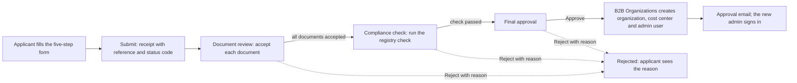

# B2B Onboarding

Verified sign-up for B2B customers on VTEX. Companies apply with their documents, store reviewers take each application through document review, a registry check and final approval, and approval creates the organization in VTEX B2B Organizations.

| | |
| --- | --- |
| App | `logixalpartnerus.b2b-onboarding` |
| Version | 0.3.1 |
| Live in | workspace `b2btest` (https://b2btest--logixalpartnerus.myvtex.com/) |
| Purpose | Customer onboarding and verification, with India business identifier checks since 0.3.0, from Logixal's development sheet |
| Status | Internal demo app for prospective clients. All demo data is labelled `TEST` |

Shorter app-store description: [docs/README.md](docs/README.md). Version history: [CHANGELOG.md](CHANGELOG.md).

## Contents

1. [What it does](#what-it-does)
2. [Where to find it](#where-to-find-it)
3. [The flow](#the-flow)
4. [Applicant journey](#applicant-journey)
5. [Reviewer journey](#reviewer-journey)
6. [Rules and settings](#rules-and-settings)
7. [Testing step by step](#testing-step-by-step)
8. [Test data and clean-up](#test-data-and-clean-up)
9. [Development and release](#development-and-release)
10. [Technical reference](#technical-reference)
11. [Known limitations](#known-limitations)

## What it does

VTEX B2B Organizations already has a sign-up form. This app replaces it with a verified, staged process.

| Topic | VTEX's native request form | B2B Onboarding |
| --- | --- | --- |
| Application | One form: company name, admin and address | Guided five-step form: Company, Administrator, Address, Documents, Review |
| Documents | None. The tax ID is a free-text field | Business registration certificate and tax certificate (PDF, JPG or PNG, up to 5 MB each) |
| Verification | None | Eligibility check against a company registry, and for India PAN, IEC, Udyam and bank account checks with name matching (both simulated in this demo) |
| Review | One Approve or Decline | Configurable stages. By default: Document review, then Compliance check, then Final approval |
| Per-document decisions | No | Accept or reject each document, with internal notes |
| Audit trail | No | Every step, with who did it, when, and notes |
| Applicant status | A banner in the applicant's own browser | Status page reached with a reference and a one-time status code, showing the current step or the rejection reason |
| Result of approval | Organization, cost center, admin user, email | The same, created through B2B Organizations' own API |

## Where to find it

All links are for the final B2B store, workspace `b2btest`. Because it's a workspace, the store asks for a VTEX Admin login before it shows any page.

| Who | What | Where |
| --- | --- | --- |
| Applicant | Application form | `/business-application`. The theme's "Organization Signup" link and `/organization-request` lead here through a store redirect |
| Applicant | Application status | `/business-application/status`, with the reference and the status code from the receipt |
| Reviewer | Review queue | Admin menu **Apps → Installed Apps → B2B onboarding**, or `/admin/b2b-onboarding` |
| Reviewer | Organizations created | **B2B Organizations → Organizations**. Each approval also appears under Organization Requests as an approved request |

## The flow

An application always moves forward one stage at a time. It can be rejected at any stage, and it ends either approved or rejected.



Stages come from the app's settings. The three above are the default, and each application keeps the stages it was submitted with, even if the settings change later.

## Applicant journey

1. **Company:** country of registration, legal company name, trade name (optional), company registration number, tax ID (optional). For India, also the business's PAN, the Udyam registration number (optional) and "Do you import or export?". Yes asks for the IEC.
   - **India only:** a Bank account step follows, with account number, IFSC and account holder name, so India applications have six steps.
2. **Administrator:** first and last name, email, phone (optional). This person becomes the organization's admin and receives the approval email.
3. **Address:** street, number, suite, city, state or region, postal code, receiving contact. The country was chosen on the Company step and is shown here with a Change link.
4. **Documents:** business registration certificate and tax certificate, dragged in or browsed. Each becomes a file card with a Replace button.
5. **Review:** every answer, with Edit links back to each step. Then **Submit application**.

Each step is checked before Continue. Back keeps what was typed. Beside the form, "What happens next" explains the review stages, and "Your application so far" fills in as the applicant goes.

After submitting, the applicant sees a receipt with a **reference** (`APP-XXXXXXXX`) and a **status code**. The status code is shown only once, and the store keeps only a scrambled version, so it can't be recovered or resent. With both, the status page shows *In review* with the current step, *Approved*, or *Not approved* with the reviewer's reason.

## Reviewer journey

Done in VTEX Admin by anyone with the Buyer Organization View and Edit permissions, for example the `b2b-admin` role.

**Review queue.** Newest first. Filters: All, In review, Waiting for approval, Approved, Rejected. Each row shows the reference, company, registration number, submission date, a progress bar with the current step, and a status tag.

**Application page:**

- A stepper with the stages, then the current step's actions.
- Company, address and administrator details.
- Documents: **View** opens the file in a viewer with a download link. **Accept** or **Reject** each one, with an optional internal note.
- Eligibility check: the result, the provider and its reference.
- For India: the identifiers, with PAN and account number masked (**Show full number** opens one and is recorded), and each identifier check with its result, name match and any decision. Checks that need a review have **Accept** and **Reject**, which need a note of 10 to 1000 characters.
- Audit trail: every step in order, with who and when.

**What each stage needs:**

| Stage | Reviewer does | Can pass when |
| --- | --- | --- |
| Document review | Views and accepts or rejects each document | Every document is accepted |
| Compliance check | Clicks Run check. For India, accepts or rejects each identifier check that needs a review | The eligibility check passed, and every identifier check is verified or accepted. A failed or rejected check can only be rejected |
| Final approval | Clicks Approve and create organization | Always. It takes a few seconds |

At any stage, **Reject application** asks for a reason of 10 to 500 characters. The applicant sees the reason. Notes stay internal.

**What approval creates:**

- The organization, with the company's name and trade name.
- A cost center called "*Company name* HQ", with the business address. Its business document is the tax ID, or the registration number when there's no tax ID.
- The administrator user from the Administrator step, with the Organization Admin role.
- VTEX's standard approval email to that administrator.

## Rules and settings

### Simulated company registry

This demo has no real registry. The check decides by the last digit of the registration number:

| Registration number ends in | Example | Result |
| --- | --- | --- |
| 0 | `TEST-100120` | Failed: not found |
| 9 | `TEST-100129` | Failed: dissolved |
| anything else | `TEST-100123` | Passed: active |

A real registry or KYB provider can replace it behind the `EligibilityVerifier` interface without changing the rest of the app.

### Simulated KYC provider (India)

Identifier checks decide by the last digit of each number (for the PAN, its 4 digits):

| Number ends in | Result |
| --- | --- |
| 0 | Failed: not found |
| 5 | Needs review: the provider couldn't decide |
| anything else | Verified, with the company name as the registered name |

The bank account's registered name is the account holder name given. When the account number ends in 7, its last real word becomes ENTERPRISES, which gives a partial name match. Name matching ignores words such as Pvt, Ltd and the TEST prefix, scores the shared words, and calls 0.85 or more a match, 0.5 or more a partial match (needs review), and less no match (failed). Demo company names need at least two real words, such as `TEST - KYC Demo Pvt Ltd`.

The provider is picked by the **KYC provider (India)** setting. A real provider is one new class behind `KycProvider` plus an option in the setting.

### Documents

- PDF, JPG or PNG only, judged by the file's contents, not its name. A text file renamed to `.pdf` is refused.
- Up to 5 MB each. Both documents are required.
- Stored privately under random names, and opened only through the review screens.

### Approval stages

Set in Admin under the app's settings (**Approval stages**). Each stage has a label, an optional ID and a type: Review, Verification or Approval. Use exactly one Approval stage, as the last stage, and at most one Verification stage. With no stages set, or invalid settings, the default three apply.

### Permissions

| Who | Needs |
| --- | --- |
| Applicants | Nothing. The form and status page are public. (`b2btest` itself asks for a workspace login, because it's a workspace) |
| Reviewers, to see applications | License Manager: Buyer Organizations → Buyer Organization View |
| Reviewers, to act | License Manager: Buyer Organizations → Buyer Organization Edit |

### Protection on the public form

- Every field is checked again on the server.
- A hidden field catches simple bots.
- A rate limit of 5 applications and 30 status checks per visitor every 10 minutes.

## Testing step by step

Run these in `b2btest`.

> **Before you start**
>
> - Log in to VTEX Admin in the same browser.
> - Have two small sample PDFs ready, never real company documents.
> - For the approval test, use an email inbox you control. A Gmail plus-address such as `yourname+onboarding1@gmail.com` lands in your inbox but counts as a new user.
> - Name test companies starting with `TEST -`.

### Test 1: Apply, review and approve (about 10 minutes)

- [ ] **1.** Open `/organization-request` on the store.
  *Expect:* you land on `/business-application`, the five-step form, at "Tell us about your company".
- [ ] **2.** Enter a company name such as "TEST - Onboarding Manual 1" and a registration number ending in 1 to 8, for example `TEST-100123`. Click Continue.
  *Expect:* the stepper marks Company as Done, and "Your application so far" shows the company.
- [ ] **3.** Enter the administrator's first and last name and your plus-address email. Click Continue.
  *Expect:* the Address step opens.
- [ ] **4.** Fill in the address, choose a country other than USA (for example IND), and click Continue.
  *Expect:* no error. The Documents step opens, with the demo notice and two upload boxes.
- [ ] **5.** Drag or browse a sample PDF into each box. Click Continue to review.
  *Expect:* each box becomes a green file card with Replace. Review shows four sections with Edit links.
- [ ] **6.** Click Edit on Address, change something, continue back to Review, then click Submit application.
  *Expect:* the change shows on Review. After submitting: "Application received", with a reference and a status code.
- [ ] **7.** Copy the status code. Click Check application status, paste the code, click Check status.
  *Expect:* the reference is pre-filled, and the result is "In review", current step "Document review".
- [ ] **8.** In Admin, open **Apps → Installed Apps → B2B onboarding**.
  *Expect:* your application is at the top, "Step 1 of 3: Document review", status In review.
- [ ] **9.** Open it. Click View on each document.
  *Expect:* the viewer shows the PDF, with a download link under the original file name.
- [ ] **10.** Accept both documents, then click Pass "Document review".
  *Expect:* Pass stays disabled until both are accepted. Then the step changes to Compliance check.
- [ ] **11.** Click Run check, then Pass "Compliance check".
  *Expect:* "Passed · Active company registered in …". The step changes to Final approval, and the queue shows "Waiting for approval".
- [ ] **12.** Click Approve and create organization.
  *Expect:* after a few seconds, "This application is closed", "Organization created in B2B Organizations (ID …)", and the audit trail ends with "Approved, organization created".
- [ ] **13.** Open **B2B Organizations → Organizations**.
  *Expect:* the new organization is active, with one cost center "… HQ" and your plus-address as Organization Admin.
- [ ] **14.** Check your inbox, and check the status page again with your reference and code.
  *Expect:* VTEX's approval email has arrived. The status page shows "Approved".
- [ ] **15.** In the same browser, open the store, click Sign in and log in with the plus-address using the email access code.
  *Expect:* you're signed in as the new administrator, inside the new organization.

### Test 2: Failed check and rejection (about 5 minutes)

- [ ] **1.** Submit a new application with a registration number ending in 0, for example `TEST-100120`. Keep its reference and code.
  *Expect:* "Application received".
- [ ] **2.** In the queue, open it, accept both documents and pass Document review.
  *Expect:* the step changes to Compliance check.
- [ ] **3.** Click Run check.
  *Expect:* "Failed · No company with registration number … in the registry". Pass "Compliance check" stays disabled.
- [ ] **4.** Click Reject application. Type a short reason (under 10 characters), then a full one.
  *Expect:* the Reject button stays disabled until the reason has 10 characters.
- [ ] **5.** Confirm the rejection.
  *Expect:* the application is closed, and the page shows "Reason given to the applicant: …". The queue tag says Rejected.
- [ ] **6.** On the status page, check the application with its reference and code.
  *Expect:* "Not approved", with your reason.

### Test 3: Form checks (about 5 minutes, nothing submitted)

- [ ] **1.** On step 1, click Continue with every field empty.
  *Expect:* "Required" under company name and registration number, and "Please correct the highlighted fields."
- [ ] **2.** On the Administrator step, enter `not-an-email` as the email and click Continue.
  *Expect:* "Check the format" under Email.
- [ ] **3.** On the Address step, change the country several times.
  *Expect:* the selection changes and nothing breaks.
- [ ] **4.** On Documents, click Continue with no files, then add a `.txt` file.
  *Expect:* "Upload this document", then "Use a PDF, JPG or PNG file".
- [ ] **5.** Click Back several times, then Continue.
  *Expect:* everything typed earlier is still there.
- [ ] **6.** On the status page, enter any reference with a wrong code.
  *Expect:* "No application matches this reference and status code."

### Test 4: India identifiers (about 10 minutes)

- [ ] **1.** On `/business-application`, choose IND as the country of registration.
  *Expect:* the stepper shows six steps, with Bank account second, and an "Indian business identifiers" section appears.
- [ ] **2.** Enter `ABCPD1234X` as the PAN and leave the field.
  *Expect:* "This is an individual's PAN…".
- [ ] **3.** Enter `ABCCD1231X`. Choose Yes for "Do you import or export?" and enter IEC `ABCDE12341`. Use a company name with two real words, such as "TEST - KYC Demo Pvt Ltd".
  *Expect:* the IEC field appears only after Yes.
- [ ] **4.** On Bank account, enter `123456789017`, IFSC `TEST0001234` and the company name as holder. Finish and submit.
  *Expect:* Review shows a Bank account section. "Application received".
- [ ] **5.** In Admin, open it, accept both documents, pass Document review and click Run check.
  *Expect:* PAN and IEC Verified. Bank account "Needs review", name partly matches. Pass is disabled with a hint.
- [ ] **6.** Click Accept on the bank check, type a short note, then a full one, and confirm.
  *Expect:* Confirm stays disabled under 10 characters. Then "Accepted by reviewer", Pass is enabled, and the audit trail shows the decision with the note.
- [ ] **7.** Click Show full number next to the PAN.
  *Expect:* the full PAN, and "Full identifier opened · PAN" in the audit trail.

For a failed check, use an IEC ending in 0: the stage can then only be rejected.

### Test 5: Reviewer access (needs a second Admin user)

- [ ] **1.** Log in to Admin as a user without the `b2b-admin` role, or any other role holding Buyer Organization View.
  *Expect:* the login works.
- [ ] **2.** Open `/admin/b2b-onboarding`.
  *Expect:* the queue fails to load applications. This hasn't been tested yet, so please record what you see.

## Test data and clean-up

- **Applications, organizations and users are shared across the whole account,** including the live B2C store's workspace. Anything created in a test is real account data.
- Approving an application creates a real organization and user. Use `TEST -` company names and inboxes you control.
- **Demo queue kept on purpose:** `APP-N7MUG7CX` (waiting at Final approval, for approving live in a demo), `APP-5VKMQCZC` (approved) and `APP-PKPM6CQD` (rejected, with a full audit trail).
- The India test applications from 2026-11-23 were deleted the same day. To delete test applications by hand: their `b2b_onboarding_event` records (search by `applicationId`), their stored files in `BD` (list them and pick by `applicationId`, which can't be filtered on), then the application. A `storageId` is `documentId/fileName`.
- The app has no delete button. Test applications are deleted by a developer through the Master Data API, together with their history events and their stored documents in entity `BD`.

## Development and release

Develop in workspace `b2bdev`, which has the same B2B stack and theme as `b2btest`. Never `vtex link` in `b2btest`.

```bash
vtex whoami                      # confirm the workspace first
yarn install && (cd node && yarn) && (cd react && yarn)
yarn lint                        # 0 errors
yarn test                        # unit tests in node/__tests__
(cd node && npx tsc --noEmit)
(cd react && npx tsc --noEmit)
vtex link --no-watch             # in b2bdev
```

To release:

1. Bump the version in `manifest.json` and add a CHANGELOG entry. Commit.
2. Run `vtex publish`.
3. Run `vtex use b2btest`, then `vtex whoami`, then `vtex install logixalpartnerus.b2b-onboarding@<version>`. Switch back to `b2bdev` afterwards.
4. Wait until `POST /_v/b2b-onboarding/status` with any reference returns `{"code":"NOT_FOUND"}`. It can take a few minutes after an install; see below.
5. Run Test 1 in `b2btest`.

## Technical reference

| Part | Details |
| --- | --- |
| Builders | node 7.x, graphql 2.x, react 3.x, store 0.x, admin 0.x, messages 1.x, docs 0.x |
| Store pages | `store.custom#b2b-onboarding-apply` (`react/ApplyPage.tsx`) and `store.custom#b2b-onboarding-status` (`react/StatusPage.tsx`), added by the app with no theme change |
| Admin pages | `react/ReviewQueue.tsx` and `react/ReviewDetail.tsx`, at `/admin/app/b2b-onboarding` and `/:id` |
| Public endpoints | `POST /_v/b2b-onboarding/apply` (multipart: fields plus the two files) and `POST /_v/b2b-onboarding/status` (JSON: `reference`, `token`). They're REST so the status code never appears in a URL |
| Reviewer GraphQL | `onboardingApplications`, `onboardingApplication`, `onboardingStages` and `onboardingDocument` need Buyer Organization View. `reviewDocument`, `runVerification` and `decideStage` need Buyer Organization Edit |
| Applications | Master Data v2 entity `b2b_onboarding_application`, schema `v1`. The document ID is the reference |
| History | Master Data v2 entity `b2b_onboarding_event`, schema `v1`. Document reviews live on each document and are merged into the history by the API |
| Documents | Master Data v1 entity `BD`, one document per file, under a random ID and random file name |
| India KYC | `node/verification/kyc.ts` (`KycProvider`, `runKycChecks`), `mockKyc.ts`, `kycProviders.ts` (the setting). Rules in `node/domain`: `indiaIdentifiers.ts` (formats and masking, with an identical copy in `react/utils/` checked by a test), `nameMatch.ts` and `kycOutcome.ts` (`verificationOutcome`) |
| India data | On the application: `india`, `kycChecks`, `kycDecisions` and `identifierReveals`, none indexed. Decisions and reveals are merged into the history by the API, like document reviews. The GraphQL `Application.india` type only has masked fields; `revealIdentifier` returns a full value and records it |
| Approval | Calls `createOrganizationRequest`, then `updateOrganizationRequest(approved)`, on `vtex.b2b-organizations-graphql` 2.x, with the reviewer's own admin token. The new organization gets the request's ID |
| Admin menu | `admin/navigation.json` uses the 3.x shape `[{"section": "storeSetup", "titleId", "path": "/admin/b2b-onboarding"}]`, which shows under Apps → Installed Apps |
| Store redirect | `/organization-request` → `/business-application`, set per workspace in `b2bdev` and `b2btest`, not in `master` |

### Code layout

```text
admin/        Admin routes and menu entry
graphql/      Reviewer GraphQL schema
messages/     UI text (generated from react/utils/messages.ts and react/admin/messages.ts)
node/
  clients/       B2B Organizations, Master Data and attachment clients
  domain/        Pure logic: validation, stages, workflow, documents (unit-tested)
  resolvers/     Reviewer GraphQL resolvers
  routes/        Public apply and status endpoints
  storage/       Master Data schemas, repository, document store
  verification/  EligibilityVerifier interface and the mock registry
  __tests__/     Unit tests
react/        Applicant pages, Admin pages and shared components
store/        Store routes and blocks
```

### Things that will bite you

- **After a first install or a new version, Master Data refuses the app for a few minutes,** and up to about 17 after the first install in a workspace. A fresh `vtex link` after an install took about 8. Wait until the status endpoint returns `NOT_FOUND` before testing.
- **A Master Data v2 schema change locks that entity's schemas for about 12 hours.** Change schemas rarely. The app writes a schema when its title differs or a property is missing. Since 0.3.0, keep the titles as they are: 0.2.2 rewrites the schema whenever the title differs from its own.
- **Older versions drop fields they don't know.** The app saves whole documents, so an older version acting on a newer record removes its newer fields. Keep every workspace on the same version.
- Master Data v2 checks a PATCH against the schema's `required` fields, so the app always writes whole documents.
- New GraphQL fields need a new minor version. Fields added with `extend type Query` return null.
- React 16 reuses change events: read `e.target.value` before calling a state updater. This crashed the country field in 0.2.0.
- Test with every input changed from its default, including dropdowns.

## Known limitations

- Reviewers get no email about new applications. They check the queue.
- Applicants get no email with their reference and status code, and the code can't be recovered.
- The eligibility check and the identifier checks are simulated.
- PAN and bank account numbers aren't encrypted at rest. Master Data v2 has no field-level access control, so anyone allowed to read the entity through the Master Data API can read them.
- GSTIN isn't checked. The tax ID stays a free-text field.
- Documents in Master Data v1 can be read by anyone who knows both their random ID and file name. Neither ever leaves the server, but real company documents should move to private file storage behind the `DocumentStore` interface.
- The rate limit is per server instance and resets on restart. A public launch needs a CAPTCHA or an edge rate limit.
- Refusal of a reviewer without Buyer Organization permissions hasn't been tested yet (Test 4).
