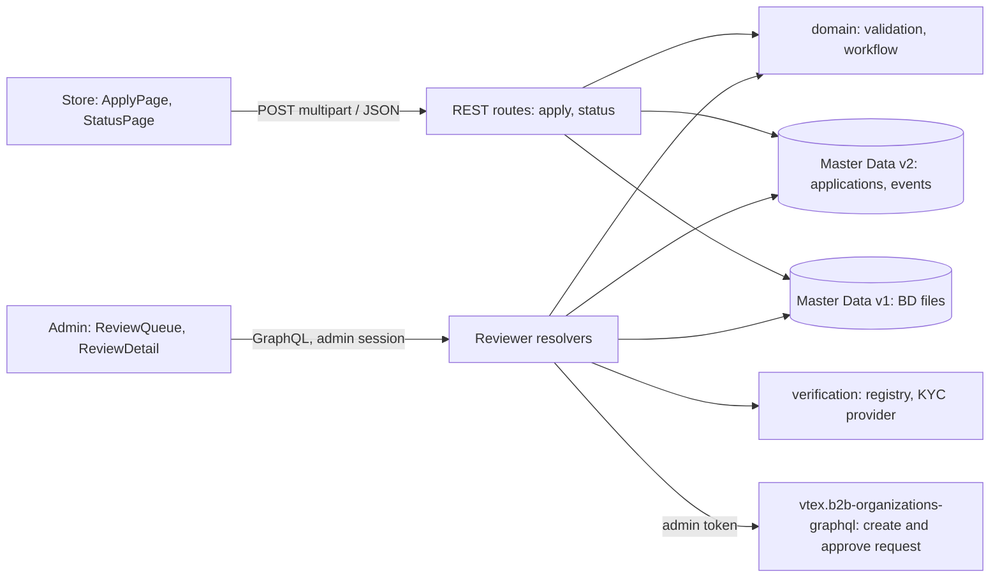

# B2B Onboarding: technical reference

How the app is built, what it stores and why. For what applicants and reviewers see, read [USER-GUIDE.md](USER-GUIDE.md).

| | |
| --- | --- |
| App | `logixalpartnerus.b2b-onboarding` 0.3.3 |
| Builders | `node` 7.x, `graphql` 2.x, `react` 3.x, `store` 0.x, `admin` 0.x, `messages` 1.x, `docs` 0.x |
| Depends on | `vtex.b2b-organizations-graphql` 2.x, `vtex.store` 2.x, `vtex.styleguide` 9.x, `vtex.render-runtime` 8.x, `vtex.css-handles` 0.x |
| Stored data | Master Data v2: `b2b_onboarding_application`, `b2b_onboarding_event`. Master Data v1: `BD` (files) |
| Used by | `logixalpartnerus.b2b-control-center` reads its GraphQL from the browser |

## Contents

1. [Architecture](#architecture)
2. [Pages](#pages)
3. [Public REST routes](#public-rest-routes)
4. [Reviewer GraphQL](#reviewer-graphql)
5. [Workflow](#workflow)
6. [Verification](#verification)
7. [Approval](#approval)
8. [Data model](#data-model)
9. [Security](#security)
10. [Policies, clients and service](#policies-clients-and-service)
11. [Code layout](#code-layout)
12. [Extending it](#extending-it)
13. [Things that will bite you](#things-that-will-bite-you)

## Architecture



- **`node/domain`** holds every rule as pure functions: validation, stages, workflow transitions, document checks, India identifier formats, name matching. Routes and resolvers only load, call the domain, and save.
- A transition returns `{ patch, events, effect }`; `applyTransition` saves the patch (whole document) and adds the events in order. `effect: CREATE_ORGANIZATION` is the only side effect, handled by the approval code.

## Pages

| Page | Route or block | Component |
| --- | --- | --- |
| Application form | `store.custom#b2b-onboarding-apply` at `/business-application` | `react/ApplyPage.tsx` |
| Status page | `store.custom#b2b-onboarding-status` at `/business-application/status` | `react/StatusPage.tsx` |
| Review queue | `/admin/app/b2b-onboarding` (Admin menu: `/admin/b2b-onboarding`) | `react/ReviewQueue.tsx` |
| Application page | `/admin/app/b2b-onboarding/:id` | `react/ReviewDetail.tsx` |

- Store pages are added by the app (`store/routes.json`), so no theme change is needed. They use inline styles from `react/utils/theme.ts` plus CSS handles.
- The Admin menu entry (`admin/navigation.json`) uses the 3.x shape `[{ "section": "storeSetup", "titleId", "path" }]`; a v4 `storeSettings/storeFront` entry built but never appeared, and `section: customers` was rejected.
- The form mirrors the server's rules in `react/utils/fields.ts`. India rules live in `node/domain/indiaIdentifiers.ts`, with an identical copy in `react/utils/` that a test keeps identical.

## Public REST routes

`node/service.json`, both `public: true`. They're REST, not GraphQL, because the store sends GraphQL queries as GET with variables in the URL, which would put the status code in logs.

### `POST /_v/b2b-onboarding/apply`

Multipart form: nested field names (`contact.email`, `address.city`, `india.pan`), the honeypot `website`, and one file per kind (`REGISTRATION_CERTIFICATE`, `TAX_CERTIFICATE`).

| Answer | When |
| --- | --- |
| `201 { reference, statusToken, submittedAt }` | Stored. The token is returned once and never stored |
| `400 { code: "INVALID_FIELDS", fields: [{ field, code }] }` | Any field or file invalid. Codes: `REQUIRED`, `TOO_SHORT`, `TOO_LONG`, `INVALID_FORMAT`, `REJECTED`, `MISSING`, `EMPTY`, `TOO_LARGE`, `UNSUPPORTED_TYPE`, `PAN_NOT_BUSINESS` |
| `400 { code: "MALFORMED" }`, `413 { code: "TOO_LARGE" }` | Unreadable form, or over the limits (40 fields, 1000 bytes per field, 5 MB per file) |
| `415 { code: "UNSUPPORTED_MEDIA_TYPE" }` | Not multipart |
| `429 { code: "TOO_MANY_REQUESTS" }` | More than 5 applications per client in 10 minutes |
| `503 { code: "UNAVAILABLE" }` | Anything unexpected (see Security) |

Order of work: rate limit, parse, validate fields and files (file type from the first bytes, not the name), pick a free reference (3 tries), store each file in `BD`, create the application with the stages from the settings, add the `SUBMITTED` event. Files go first so an application never exists without them.

### `POST /_v/b2b-onboarding/status`

JSON `{ reference, token }`, at most 2 KB.

| Answer | When |
| --- | --- |
| `200 { reference, companyName, status, currentStageLabel, rejectionReason, submittedAt, decidedAt }` | Reference and token match |
| `404 { code: "NOT_FOUND" }` | Malformed reference, unknown reference or wrong token: one answer for all, so references can't be probed |
| `400 { code: "MALFORMED" }` | Not JSON |
| `429` | More than 30 checks per client in 10 minutes |

Every answer has `Cache-Control: no-store`. The status route doubles as the health check after an install: `NOT_FOUND` for a made-up reference means the app can read Master Data.

## Reviewer GraphQL

`graphql/schema.graphql`. Every operation has `@auth(scope: PRIVATE, productCode: "97")`: reads need `buyer_organization_view`, writes `buyer_organization_edit`. Reads have `@cacheControl(scope: PRIVATE)`; mutations none.

| Operation | Does |
| --- | --- |
| `onboardingApplications(status, page, pageSize)` | Newest first, page size up to 50 |
| `onboardingApplication(id)` | One application, with `currentStage`, `events` (stored events plus document reviews, check decisions and reveals merged in), masked `india`, `kycChecks` with their latest decision, `verificationOutcome` |
| `onboardingStages` | The stage configuration and any problems with the settings |
| `onboardingDocument(id, kind)` | The file as base64 (5 MB at most), with our own record of its type |
| `reviewDocument(id, stageId, kind, decision, note)` | Accept or reject one document, on a review stage |
| `runVerification(id, stageId)` | Registry check and, for India, all identifier checks; on the verification stage |
| `decideKycCheck(id, stageId, kind, decision, note)` | Accept or reject a check that needs review; note 10 to 1000 characters |
| `revealIdentifier(id, field)` | The full PAN or account number; records the reveal first and returns nothing if recording fails |
| `decideStage(id, stageId, decision, reason, note)` | Pass the stage, reject the application, or, on the approval stage, approve |

Refusals are `UserInputError` (HTTP 400) with the workflow's message and its code in `extensions.code` (since 0.3.3; `@vtex/api`'s own code is always `BAD_USER_INPUT`): `STAGE_MISMATCH`, `NOT_IN_REVIEW`, `NOT_REVIEW_STAGE`, `NOT_VERIFICATION_STAGE`, `DOCUMENT_NOT_FOUND`, `DOCUMENTS_NOT_ACCEPTED`, `VERIFICATION_REQUIRED`, `VERIFICATION_FAILED`, `KYC_DECISION_REQUIRED`, `KYC_CHECK_NOT_FOUND`, `KYC_CHECK_NOT_UNDECIDED`, `NOTE_REQUIRED`, `REASON_REQUIRED`, `IDENTIFIER_NOT_FOUND`, `APPROVAL_FAILED`. Every mutation takes the `stageId` the reviewer saw; a different current stage gives `STAGE_MISMATCH`.

## Workflow

`node/domain/workflow.ts` and `stages.ts`.

- **Stages** come from the app setting `stages` (up to 8; IDs `^[a-z0-9][a-z0-9-]{0,39}$`, or made from the label), or the default three. Exactly one `APPROVAL` stage, last; at most one `VERIFICATION`. Invalid settings fall back to the defaults and report their problems. Each application keeps a copy of its stages.
- **Status:** `IN_REVIEW` → `APPROVED` or `REJECTED`. Applications only move forward, one stage at a time.

| Stage type | Can pass when |
| --- | --- |
| `REVIEW` | Every document's latest review is `ACCEPTED` |
| `VERIFICATION` | `verificationOutcome` is `READY`: registry check passed, and every identifier check `VERIFIED` or accepted by a reviewer |
| `APPROVAL` | Always; passing it is the approval |

`verificationOutcome`: `NOT_RUN`, `BLOCKED` (a failed or rejected check: only rejection is possible), `NEEDS_DECISION`, `READY`.

Rejection is possible at any stage, with a reason of 10 to 500 characters; notes are up to 1000.

## Verification

| Interface | File | Today |
| --- | --- | --- |
| `EligibilityVerifier.verify({ companyName, registrationNumber, address })` | `verification/types.ts` | `MockRegistryVerifier`, by the registration number's last digit |
| `KycProvider`: `verifyPan`, `verifyIec`, `verifyUdyam`, `verifyBankAccount` | `verification/kyc.ts` | `MockKycProvider`, by each number's last digit; picked by the setting `kycProvider` (`kycProviders.ts`) |

`runKycChecks` runs the applicable checks (IEC only for importers or exporters, Udyam only when given) and turns each `KycResult` into a `KycCheck`: the provider's status, plus a name match (`nameMatch.ts`) between the registered name and the company name. `effectiveStatus` is the worse of the two: a strong match keeps the status, a partial match needs review, no match fails.

Name matching normalizes case and punctuation, drops legal suffixes (Pvt, Ltd, Private, Limited, LLP and so on) and the `TEST` prefix, and scores shared words: 0.85 or more is `STRONG`, 0.5 or more `PARTIAL`, less `NONE`.

## Approval

`node/resolvers/review.ts`, `approve`:

1. If the application has no `organizationRequestId`, `createOrganizationRequest` (with `notifyUsers: false`, `retries: 0`) on `vtex.b2b-organizations-graphql` 2.x, with the reviewer's admin token. The request ID is saved at once.
2. Unless the request is already approved, `updateOrganizationRequest(status: "approved", notifyUsers: true)`. B2B Organizations then creates the organization (with the request's ID), the cost center "*Company* HQ" and the admin user, and sends its email.
3. The application becomes `APPROVED`, with `organizationId` and an `APPROVED` event.

On failure: an `APPROVAL_FAILED` event with the message, the application stays at its stage, and the reviewer gets `APPROVAL_FAILED`. A retry reuses the saved request, so it can't create a second organization. B2B Organizations refuses the app token ("No token was provided"), so the app can never approve on its own authority.

## Data model

### `b2b_onboarding_application` (Master Data v2, schema `v1`)

Document ID = the reference (`APP-` + 8 characters, no 0/O/1/I). Reads by ID are immediate, so the applicant can check their status straight away; search sees new documents after a short delay.

Fields: `reference`, `tokenHash` (SHA-256 of the status code), `status`, `companyName`, `tradeName`, `registrationNumber`, `taxId`, `contact`, `address`, `stages`, `currentStageIndex`, `currentStageId`, `verification`, `india`, `kycChecks`, `kycDecisions`, `identifierReveals`, `documents` (with their `reviews`), `rejectionReason`, `organizationRequestId`, `organizationId`, `submittedAt`, `updatedAt`, `decidedAt`.

Indexed: `reference`, `status`, `currentStageId`, `companyName`, `registrationNumber`, `submittedAt`. `v-cache: false`, because reviewers act on what they just read. Documents are always written whole (PUT): Master Data checks a PATCH body against `required` on its own.

### `b2b_onboarding_event` (Master Data v2, schema `v1`)

One document per event: `applicationId`, `type`, `stageId`, `stageLabel`, `actorType` (`APPLICANT`, `REVIEWER`, `SYSTEM`), `actor`, `reason`, `note`, `details` (JSON), `createdAt`. Indexed on `applicationId`, `type`, `createdAt`. Types stored: `SUBMITTED`, `VERIFICATION_RUN`, `STAGE_PASSED`, `APPROVED`, `REJECTED`, `APPROVAL_FAILED`. Document reviews, check decisions and reveals live on the application (the event schema was locked when they were added) and are merged into the history by the API.

### `BD` (Master Data v1)

One document per file, with `applicationId`, `kind` and the attachment field `file`, under a random document ID and a random file name. `storageId` on the application is `<document ID>/<file name>`; neither ever leaves the server. Delete a file's record by the part before `/`, with `Accept: application/vnd.vtex.ds.v10+json`. The table's display name still refers to an early test; the API can't rename it, and it was kept on purpose.

## Security

- **Applicants:** status code of 24 random bytes, stored as a SHA-256 hash and compared in constant time; one answer for every lookup failure; rate limits of 5 applications and 30 status checks per client per 10 minutes (per instance, from `X-Forwarded-For`); a honeypot field; every rule checked again on the server; file types checked by content.
- **Public route errors** never return the error: the client gets `503 UNAVAILABLE`, and the log gets the message and HTTP status only, never the error object (which can hold the request, and so a PAN).
- **Master Data write errors** are replaced by `MasterDataWriteError` with the status only, for the same reason.
- **Reviewers:** License Manager rights on every GraphQL operation; their identity comes from the admin token (`sub` claim) and is written on every event.
- **Identifiers:** the GraphQL `Application.india` type only has masked fields (`XXXXX1234F`, `XXXXXXXX9012`); the full value comes only from `revealIdentifier`, which records who opened it first.
- **Approval** uses the reviewer's admin token; the app token can't approve.
- **Not done (demo):** PAN and account numbers aren't encrypted at rest, and Master Data v2 has no field-level access control. Files in `BD` can be read by anyone who knows both random parts. A public launch needs encryption, private file storage and an edge rate limit or CAPTCHA.

## Policies, clients and service

| Policy | For |
| --- | --- |
| `vtex.b2b-organizations-graphql:resolve-graphql` | Creating and approving organization requests |
| `ADMIN_DS` | Master Data |
| `outbound-access` `{{account}}.vtexcommercestable.com.br/api/dataentities/*` | Master Data v1 and v2 on the account's own host |

| Client | Type | Notes |
| --- | --- | --- |
| `AccountMasterData` | `ExternalClient` | Master Data v2 on `{account}.vtexcommercestable.com.br`, the host VTEX documents `ADMIN_DS` for (`@vtex/api`'s `MasterData` uses `api.vtex.com`). Creates aren't retried |
| `MasterDataFiles` | `ExternalClient` | `BD` documents and attachments; uploads aren't retried, 30-second timeout |
| `B2BOrganizations` | `AppGraphQLClient` | Admin token only; creating a request isn't retried |

Service (`node/service.json`): 2 to 4 replicas, 256 MB, 30-second timeout. Client defaults: 1 retry, 15-second timeout.

## Code layout

```
node/
  index.ts                Service: clients, routes, resolvers
  routes/                 applicant.ts (apply, status, guarded), multipart.ts
  resolvers/              review.ts (queries, mutations, fields), shared.ts
  domain/                 validation, stages, workflow, documents, indiaIdentifiers,
                          nameMatch, kycOutcome, statusToken, rateLimit, actor
  verification/           registry and KYC interfaces, mock providers
  storage/                schemas, repository, document store
  clients/                AccountMasterData, MasterDataFiles, B2BOrganizations
react/
  ApplyPage.tsx, StatusPage.tsx, ReviewQueue.tsx, ReviewDetail.tsx
  components/             Stepper, Fields, DropZone, Receipt, SidePanels
  admin/                  StageStepper, types, messages, country names
  utils/                  fields, India rules (copy), api, messages, theme
  graphql/                reviewer queries and mutations
graphql/schema.graphql
store/                    routes and blocks for the two store pages
admin/                    menu entry and routes
```

## Extending it

- **A real KYC provider:** one class implementing `KycProvider`, added to `PROVIDERS` in `verification/kycProviders.ts`, and an option in the `kycProvider` setting. Results keep the same shape, so the screens don't change.
- **A real registry or KYB check:** implement `EligibilityVerifier` and swap `verifier` in `resolvers/shared.ts`.
- **Private file storage:** implement `DocumentStore` (`put`, `get`) and swap `documentStore` in `resolvers/shared.ts`.
- **Notifications:** emails to reviewers on new applications, and to applicants with their reference, would go on the `SUBMITTED` and decision events.
- **GSTIN:** a new India identifier, with its format in `indiaIdentifiers.ts` and a method on `KycProvider`.
- **New stage types** need rules in `decide` and the review page; new stages of the existing types only need the setting.

## Things that will bite you

- **After an install, check data, not just pages.** On 2026-11-25 an install of 0.3.3 in `b2btest` reported a dependency conflict, listed the app as installed, and left it without Master Data access: pages rendered, but the queue said "Couldn't load applications" and the status route answered 503. A second install fixed it. Wait until `POST /_v/b2b-onboarding/status` with a made-up reference answers `NOT_FOUND`, and open the queue.
- **After a first install, Master Data refuses the app for about 15 to 17 minutes**; after a new version, a few minutes. A fresh `vtex link` after an install took about 8.
- **A Master Data v2 schema change locks that entity's schemas for about 12 hours.** The app writes a schema only when its title differs or a property is missing. Keep the titles as they are: older versions rewrite the schema whenever the title differs from their own.
- **Older versions drop fields they don't know,** because documents are saved whole. Keep every workspace on the same version.
- **New GraphQL fields need a new minor version;** fields added with `extend type Query` return null.
- **React 16 reuses change events:** read `e.target.value` before calling a state updater. This crashed the country field in 0.2.0.
- **Chrome autofills the status page** with saved logins, because the code field is a password field. Setting `autoComplete="one-time-code"` on it would stop that.
- Tests: `yarn test` runs 346 tests (domain, routes, storage, clients, resolvers and every screen); `yarn test:coverage` fails under 80% of lines (70% of branches). See [TESTING.md](TESTING.md).
