# B2B Onboarding: user guide

Every screen of the application form, the applicant's status page and the reviewer's Admin pages, with what each action does. For how it's built, see [TECHNICAL.md](TECHNICAL.md); for test steps, [TESTING.md](TESTING.md).

Examples use the `b2btest` workspace and the demo applications kept there, such as `APP-5N5UPWC4` ("TEST - KYC Demo Pvt Ltd", waiting at Compliance check).

## Contents

1. [Who does what](#who-does-what)
2. [Applying](#applying)
3. [The receipt and the status page](#the-receipt-and-the-status-page)
4. [The review queue](#the-review-queue)
5. [The application page](#the-application-page)
6. [Document review](#document-review)
7. [Compliance check](#compliance-check)
8. [Final approval](#final-approval)
9. [Rejecting](#rejecting)
10. [The audit trail](#the-audit-trail)
11. [Settings](#settings)
12. [Demo checks](#demo-checks)
13. [Messages](#messages)
14. [Common questions](#common-questions)

## Who does what

| Who | Where | Needs |
| --- | --- | --- |
| Applicant: a company asking for a business account | Store: `/business-application` and `/business-application/status` | Nothing; both pages are public. (`b2btest` asks for a workspace login first, because it's a workspace) |
| Reviewer, to see applications | Admin: **Apps → Installed Apps → B2B onboarding** | License Manager: Buyer Organizations → **Buyer Organization View** |
| Reviewer, to act | Same | Buyer Organizations → **Buyer Organization Edit**. The `b2b-admin` role has both |

The B2B theme's "Organization Signup" link can be pointed at the form with a store redirect from `/organization-request` to `/business-application`. Redirects are per workspace: `b2bdev` has it, `b2btest` doesn't.

## Applying

`/business-application`. Five steps, or six for India. Each step is checked when the applicant clicks **Continue**, and each field when they leave it; **Back** keeps what was typed. Beside the form, "What happens next" lists the review stages, and "Your application so far" fills in as they go. A hidden field catches simple bots.

### 1. Company

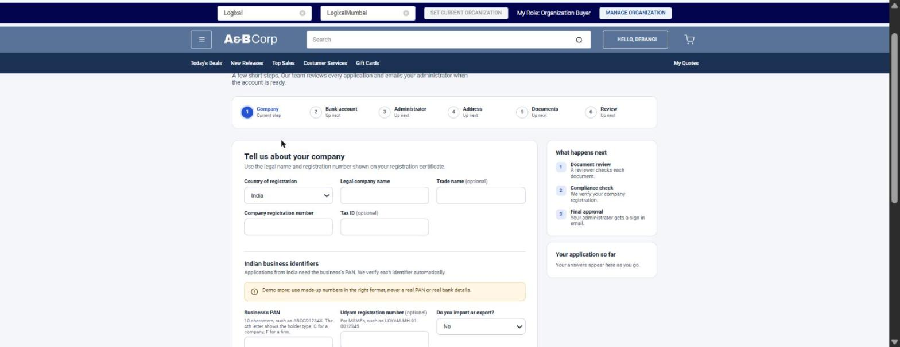

| Field | Rules |
| --- | --- |
| Country of registration | One of 10 countries; changing to or from India changes the steps |
| Legal company name | Required, 2 to 100 characters |
| Trade name | Optional, up to 100 |
| Company registration number | Required, 4 to 30 letters, digits, spaces, `.`, `/`, `-` |
| Tax ID | Optional, up to 30, same characters |

**India only**, under "Indian business identifiers":

| Field | Rules |
| --- | --- |
| Business's PAN | Required. 10 characters (5 letters, 4 digits, 1 letter); the 4th letter must be a business type (company, firm, trust and so on). An individual's PAN is refused: "This is an individual's PAN…" |
| Udyam registration number | Optional, `UDYAM-XX-00-0000000` |
| Do you import or export? | No or Yes. **Yes** adds IEC |
| IEC | Required when Yes: 10 characters |

### 2. Bank account (India only)

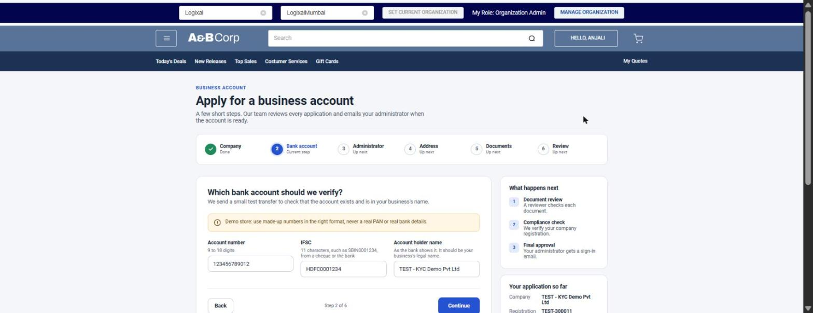

Account number (9 to 18 digits), IFSC (11 characters, such as `SBIN0001234`) and account holder name, which should be the business's legal name: the check compares them.

### 3. Administrator

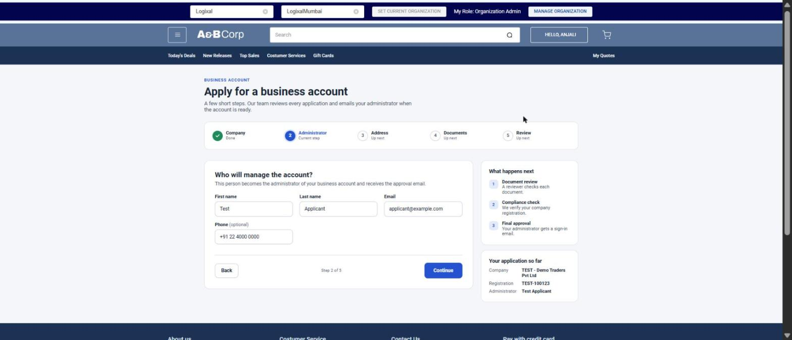

The person who becomes the organization's admin and receives VTEX's approval email: first and last name and email (required), phone (optional).

### 4. Address

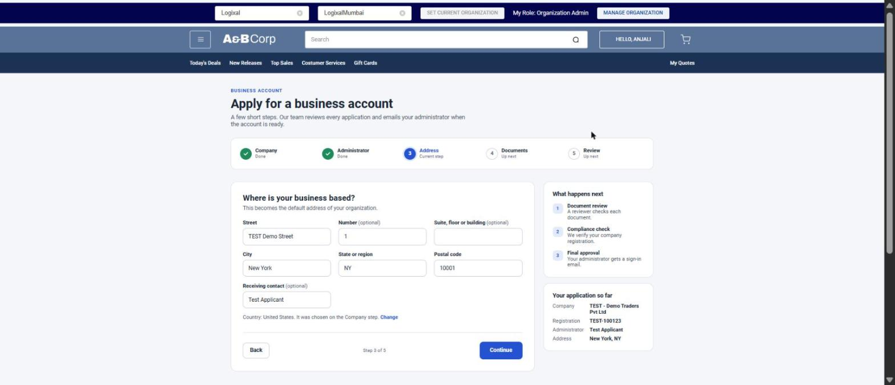

Street, city, state or region and postal code are required; number, suite and receiving contact are optional. The country shows here with a **Change** link back to the Company step. The address becomes the organization's cost center address.

### 5. Documents

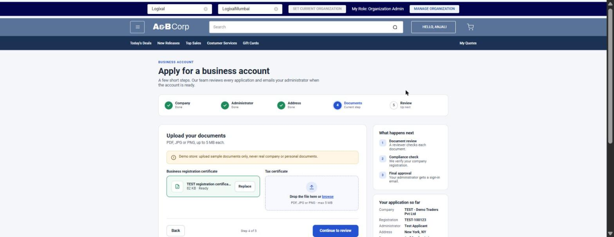

The business registration certificate and the tax certificate, both required. Drag a file onto the box or click **browse**. Each file becomes a card with its size and **Replace**.

- PDF, JPG or PNG, up to 5 MB each.
- The server checks the file's contents, not its name: a text file renamed `.pdf` is refused.

### 6. Review

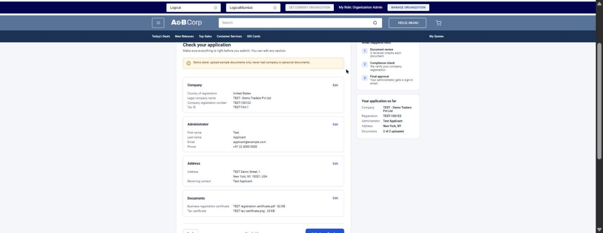

Every answer, by section, with **Edit** to go back to that step. **Submit application** sends everything; every rule is checked again on the server. If the server refuses a field, the applicant is taken back to its step with the field marked.

## The receipt and the status page

After submitting, the applicant sees **Application received** with:

- a **reference**, such as `APP-WXEYCBB2`, and
- a **status code**, shown **only once**. The store keeps only a scrambled form of it, so it can't be shown again or resent. Each has a **Copy** button.
- **Check application status**, a link to the status page with the reference filled in.

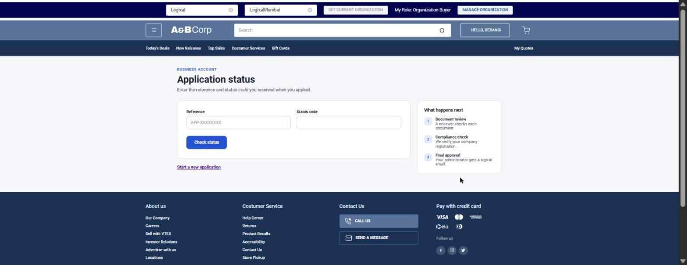

`/business-application/status`: the reference and the status code give one of:

| Shows | When |
| --- | --- |
| In review, with the current step | Still with the reviewers |
| Approved, with the date | The organization was created; the admin gets VTEX's email |
| Not approved, with the reviewer's reason | Rejected. Internal notes are never shown |
| "No application matches this reference and status code." | Wrong reference or code. The same answer for both, so references can't be guessed |

Browsers may offer to fill the status code with a saved password, because it's a password field. Clear it if so.

## The review queue

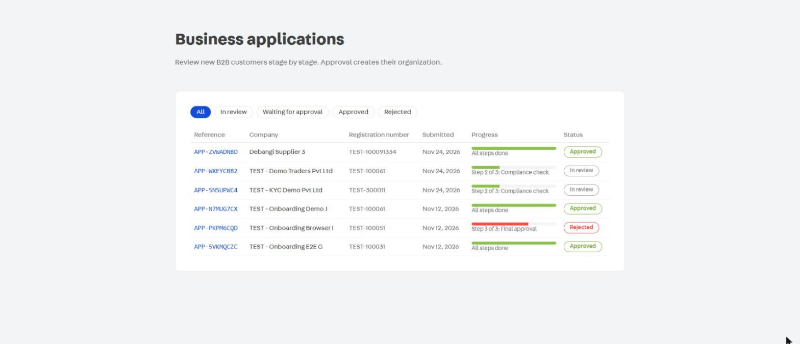

**Apps → Installed Apps → B2B onboarding** (`/admin/b2b-onboarding`). Newest first, 20 per page.

- **Filters:** All, In review, Waiting for approval (in review and at the Approval stage), Approved, Rejected.
- **Each row:** reference, company, registration number, submission date, a progress bar with "Step X of Y: stage", and a status tag. Click a row to open it.

## The application page

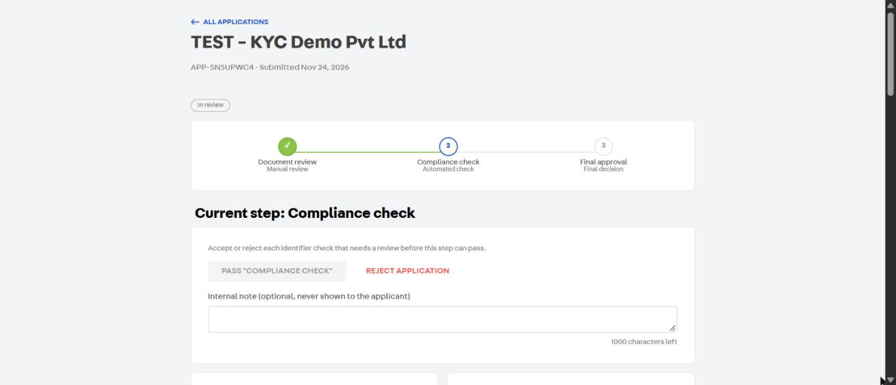

From top to bottom:

- **Company name, reference and submission date**, a status tag, and **All applications** to go back.
- **The stepper:** each stage with its type (Manual review, Automated check, Final decision); done stages are ticked.
- **Current step**, with what it needs to pass, **Pass "stage"** (or **Approve and create organization** at the last stage), **Reject application**, and an internal note for the next action.
- **Company**, India identifiers (masked), bank account (masked), business address with the country's name, and account administrator.
- **Documents**, **Eligibility check** with identifier checks, and the **Audit trail**.

Every action sends the stage the reviewer is looking at. If someone else moved the application meanwhile, the action is refused with "The application is now at …. Reload and try again."

## Document review

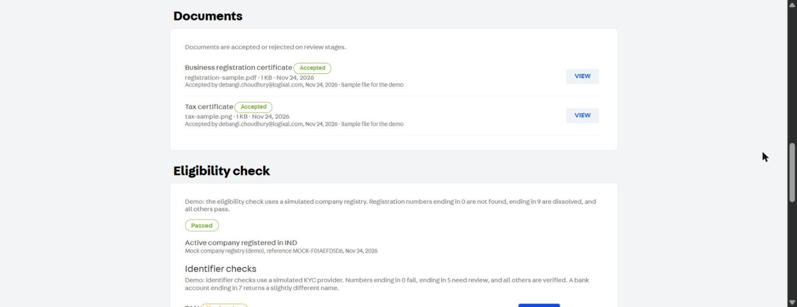

- **View** opens the file in a viewer inside the Admin, with **Download**.
- **Accept** marks the document accepted.
- **Reject** asks for an internal note first, then marks it rejected.
- **Pass "Document review"** is enabled once every document is accepted. Accepting or rejecting is only possible on a review stage; elsewhere the section says "Documents are accepted or rejected on review stages."

## Compliance check

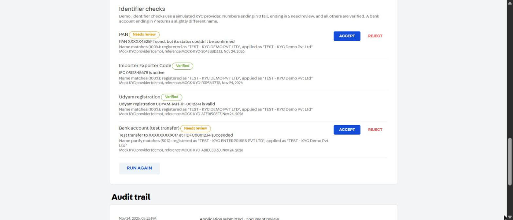

1. **Run check** (later **Run again**) checks the company registry and, for India, PAN, IEC, Udyam and the bank account. Each check shows its result, the name match ("Name matches (100%)", "partly matches (50%)") and the provider's reference.
2. A check that **Needs review** has **Accept** and **Reject**:

   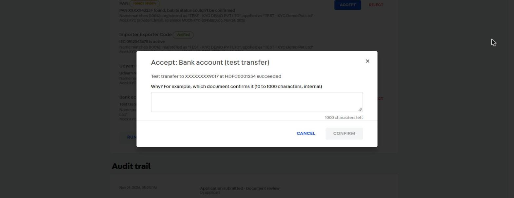

   A note of 10 to 1000 characters is required, saying why, for example which document confirms it. Notes are internal.
3. **Pass "Compliance check"** is enabled when the registry check passed and every identifier check is verified or accepted. A failed or rejected check means the application can only be rejected.

**Masked numbers.** The PAN and account number show only their last digits. **Show full number** reveals one; the audit trail records who opened it and when. **Hide** masks it again.

## Final approval

**Approve and create organization** asks VTEX B2B Organizations to create:

- the organization, with the legal and trade names;
- a cost center called "*Company name* HQ", with the business address, and the tax ID (or the registration number) as its business document;
- the administrator user, with the Organization Admin role;
- VTEX's standard approval email to that administrator.

It takes a few seconds. If B2B Organizations fails, the application stays at Final approval, the failure is recorded, and approving again reuses the same request, so it never creates two organizations.

## Rejecting

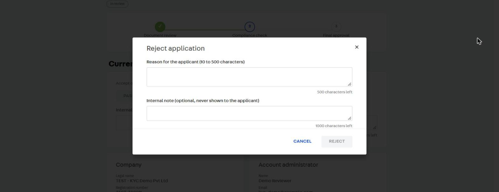

**Reject application**, at any stage, asks for:

- a **reason for the applicant**, 10 to 500 characters, shown on their status page;
- an optional **internal note**, never shown to them.

**Reject** stays disabled until the reason is long enough. A rejected application is closed; it can't be reopened.

## The audit trail

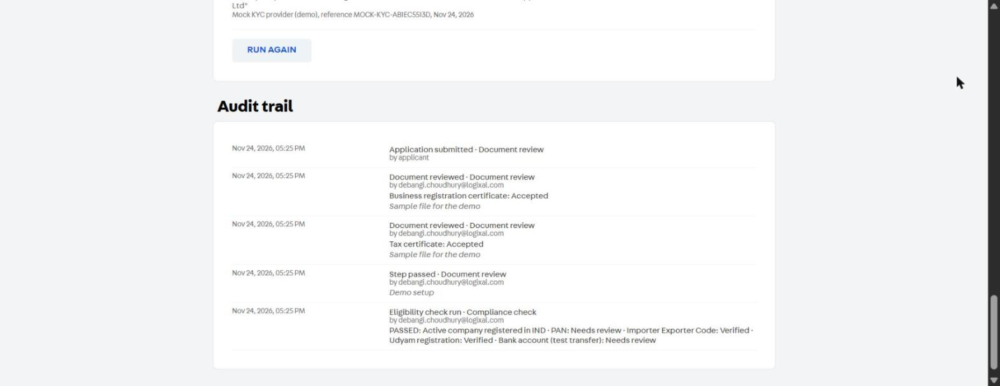

Every step in order, with who did it and when: submission, each document decision with its note, verification runs with every result, check decisions, identifiers opened in full, stages passed, rejection with its reason, approval, and failed approval attempts.

## Settings

**Apps → Installed Apps → B2B onboarding → Settings**:

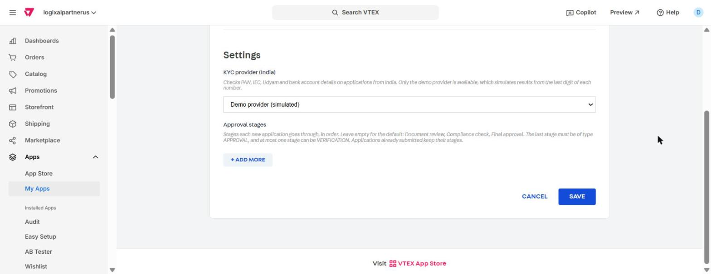

| Setting | Default | What it does |
| --- | --- | --- |
| KYC provider (India) | Demo provider (simulated) | Which provider checks Indian identifiers. Only the demo provider exists today |
| Approval stages | Empty: Document review, Compliance check, Final approval | The stages new applications go through, in order |

Approval stages: each has a label, an optional ID and a type (Review, Verification or Approval). Up to 8 stages; exactly one Approval stage, last; at most one Verification stage. Invalid settings don't break the form: the defaults apply and the review page shows what's wrong. Applications already submitted keep the stages they were submitted with.

## Demo checks

This demo has no real registry or KYC provider. The simulated ones decide by the last digit, so a demo can show every outcome:

| Check | Ends in 0 | Ends in 5 | Ends in 9 | Anything else |
| --- | --- | --- | --- | --- |
| Company registration number | Failed: not found | Passed | Failed: dissolved | Passed |
| PAN (its 4 digits), IEC, Udyam | Failed | Needs review | Verified | Verified |
| Bank account | Failed | Needs review | Verified | Verified; ending in 7 gives a partial name match |

Name matching ignores words such as Pvt, Ltd and the TEST prefix and scores the shared words: 85% or more is a match, 50% or more a partial match (needs review), less is no match (failed). The bank check compares the account holder name typed by the applicant with the company name, so a different holder fails. Demo company names need at least two real words, such as "TEST - KYC Demo Pvt Ltd".

## Messages

| Where | Message | Meaning |
| --- | --- | --- |
| Form | Please correct the highlighted fields. | A field or document needs fixing on this step |
| Form | Too many attempts… | More than 5 applications from this visitor in 10 minutes |
| Form | The upload is too large… | A file is over 5 MB |
| Form | We couldn't submit your application… | The server failed; try again |
| Status page | No application matches… | Wrong reference or code |
| Status page | Too many attempts… | More than 30 checks from this visitor in 10 minutes |
| Queue | Couldn't load applications. | The app can't read its data. After an install, wait until it can (see TECHNICAL.md) |
| Application page | The application is now at … | Someone else moved it; reload |
| Application page | Accept every document before passing this stage… | A document isn't accepted |
| Application page | Accept or reject every check that needs a manual review first | A check needs a decision |
| Application page | The verification failed, so this stage can only be rejected | A check failed or was rejected |
| Application page | B2B Organizations couldn't create the organization… | Approval failed; try again later |

## Common questions

**The applicant lost their status code. Can it be resent?** No: only a scrambled form is stored. They can submit a new application, and the old one can be rejected.

**Does anyone get an email when an application arrives?** No. Reviewers check the queue. The only email is VTEX's approval email to the new admin.

**Can an approved application be undone?** Not from here. Deactivate the organization in B2B Organizations.

**Where do approved organizations appear?** In **B2B Organizations → Organizations**, and as an approved request under its requests.

**Why can't I see Accept and Reject on documents?** They only show on a review stage.
